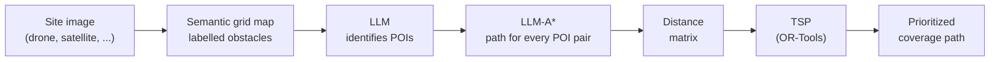
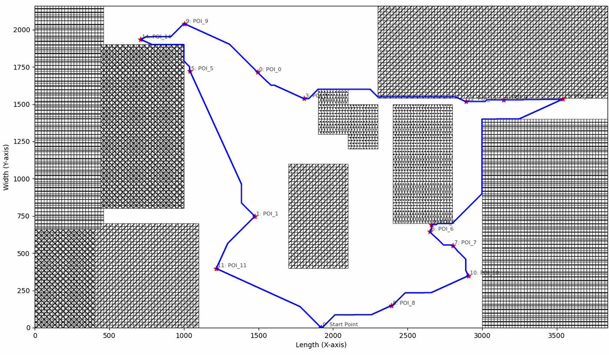
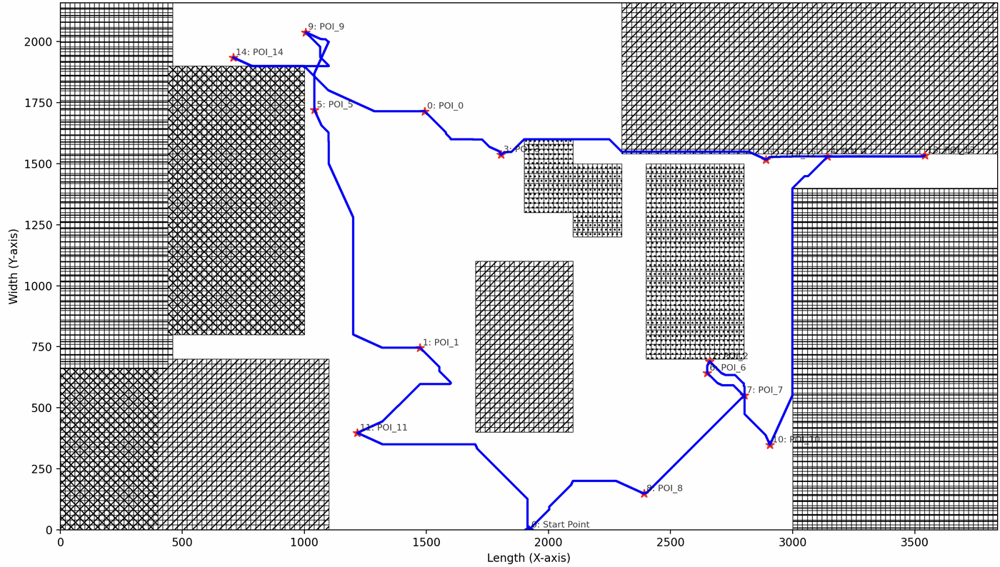

# LLM-PCPP

Code for **LLM-PCPP: A novel robot prioritized coverage path planning approach for complex environments**
Zhaofeng Hu and Ci-Jyun Liang, Stony Brook University
*42nd International Symposium on Automation and Robotics in Construction (ISARC 2025), Montreal, Canada* ·
[Paper (PDF)](https://www.iaarc.org/publications/fulltext/034_LLM-PCPP__A_novel_robot_prioritized_coverage_path_planning_approach_for_complex_environments.pdf)

LLM-PCPP plans a coverage path for a robot that has to visit the task-relevant
points of interest (POIs) of a complex environment. A large language model
(LLM) reads a semantic grid map and proposes the POIs, LLM-A* computes a path
between every pair of POIs, and the visiting order is solved as a Traveling
Salesman Problem (TSP).



| A* + TSP | LLM-A* + TSP (LLM-PCPP) |
|:---:|:---:|
|  |  |

*Experiment 1: complex outdoor construction site (3840 x 2160 grid, 15 POIs). Figures from the paper.*

## Results

Totals over all POI pairs, as reported in the paper. Across the three scenes,
LLM-A* needed 34-42% fewer search operations and 31-37% less storage than A*,
in exchange for 14-20% longer coverage paths that pass through more of the
semantically rich areas.

| Experiment | Planner | Path length (TSP) | Operations | Storage |
|---|---|---:|---:|---:|
| 1. Complex outdoor site, 3840 x 2160, 15 POIs | A* | 9,270.45 | 72,343,616 | 44,987,486 |
| | LLM-A* | 10,530.60 | 42,636,892 | 28,383,237 |
| 2. Simple outdoor site, 3024 x 1890, 12 POIs | A* | 13,562.50 | 60,556,220 | 39,494,015 |
| | LLM-A* | 16,300.53 | 39,873,931 | 26,063,827 |
| 3. Indoor warehouse, 3024 x 1890, 13 POIs | A* | 13,208.39 | 61,625,226 | 35,970,025 |
| | LLM-A* | 15,682.17 | 35,904,779 | 24,992,699 |

## Installation

Python 3.9 or newer (tested with 3.9 and 3.13).

```bash
git clone https://github.com/<your-org>/LLM-PCPP.git
cd LLM-PCPP
pip install -e .
```

Optional extras: `pip install -e ".[tools]"` installs OpenCV and Pillow for the
map construction tools, and `pip install -e ".[dev]"` installs pytest.

## Quick start

### Reproduce the A* baseline (no API key needed)

```bash
python scripts/run_experiment.py --config configs/exp1_complex_outdoor.yaml --planner astar --workers 4
```

This computes the A* paths between all 120 point pairs of Experiment 1,
solves the TSP and prints the totals next to the paper's numbers:

```text
                          this run         paper
Path length (TSP)          9270.45       9270.45
Operations                72343616      72343616
Storage                   44987486      44987486
```

Each experiment takes a few minutes (about 2 minutes with `--workers 3` on an
Apple-silicon laptop). Use `configs/exp2_simple_outdoor.yaml` and
`configs/exp3_indoor_warehouse.yaml` for the other two experiments.

### Run LLM-PCPP

```bash
export OPENAI_API_KEY=<your key>
python scripts/run_experiment.py --config configs/exp1_complex_outdoor.yaml --planner llm-astar --workers 4
```

The LLM is queried once per point pair (120 queries for Experiment 1) with the
LLM-A* prompt used in the paper and `gpt-4o` at temperature 0 (`--model`
selects another model). The raw responses are saved to
`outputs/<scene>/llm-astar/waypoints.json`; running again with the same file,
or passing it with `--waypoint-cache`, replays them without API calls.

> **Note.** LLM-A* results will differ somewhat from the paper. LLM responses
> vary between model versions and runs, and the raw GPT-4o responses of the
> paper runs were not saved. The A* baseline is deterministic and reproduces
> the paper exactly.

### Plot a scene

```bash
python scripts/plot_scene.py --config configs/exp2_simple_outdoor.yaml
```

### Outputs

Each run writes to `outputs/<scene>/<planner>/`:

| File | Content |
|---|---|
| `summary.json` | totals, TSP tour, settings, software versions and the paper's numbers |
| `pairs.csv` | length, operations, storage and waypoints of every point pair |
| `distance_matrix.csv` | pairwise path lengths |
| `coverage_path.json` | the coverage path as a list of grid cells |
| `coverage_path.png` | map, POIs and coverage path |
| `waypoints.json` | raw LLM responses (LLM-A* only) |

## Repository structure

```text
LLM-PCPP/
├── src/llm_pcpp/           # Python package
│   ├── scene.py            #   semantic grid map: obstacles, POIs, config loading
│   ├── astar.py            #   grid A* with operation and storage counters
│   ├── waypoints.py        #   LLM-A* waypoint prompt, parsing, filtering and cache
│   ├── llm.py              #   OpenAI chat model wrapper
│   ├── planner.py          #   pairwise paths -> distance matrix -> TSP -> coverage path
│   ├── tsp.py              #   TSP with Google OR-Tools
│   ├── poi.py              #   LLM-based POI identification for new maps
│   └── visualization.py    #   paper-style figures
├── configs/                # the three scenes of the paper
├── scripts/
│   ├── run_experiment.py   #   run A* or LLM-A* + TSP on a scene
│   ├── plot_scene.py       #   draw a semantic grid map with its POIs
│   ├── identify_pois.py    #   ask an LLM for POIs on a new map
│   └── tools/              #   build a grid map from a site image
├── tests/                  # unit tests and checks against the paper's run logs
├── paper_logs/             # raw logs of the paper runs
├── assets/                 # figures used in this README
└── third_party/llm-astar/  # license of the adapted LLM-A* code
```

## Method and implementation notes

- **Semantic grid map.** One grid cell per image pixel, with the origin at the
  bottom-left corner and y pointing up. Obstacles are labelled rectangles; the
  class names (e.g. "Green Fields", "Cold Storage Area") are the semantic
  information given to the LLM.
- **POIs.** The POIs in `configs/` are the ones used in the paper. They were
  generated with ChatGPT (GPT-4o for Experiment 1, o1 for Experiments 2 and 3).
  `scripts/identify_pois.py` runs this step through the API for new maps; its
  prompt follows the description in the paper and is not the exact chat prompt
  used for the published POIs.
- **LLM-A\*.** For every point pair the LLM proposes waypoints
  ([prompt](src/llm_pcpp/waypoints.py), adapted from
  [LLM-A*](https://github.com/SilinMeng0510/llm-astar) to rectangular
  obstacles). Waypoints inside obstacles or next to the map border are
  dropped, and A* runs segment by segment through the remaining waypoints.
- **Metrics.** *Operations* counts the pops from the A* open list and
  *storage* the grid cells that received a cost-to-come value. For LLM-A* both
  are summed over the segments, and every metric is summed over all point
  pairs. Path length counts 1 per axis-aligned step and 1.414 per diagonal step.
- **TSP.** Google OR-Tools with the `PATH_CHEAPEST_ARC` first-solution strategy
  and the default local search, on the pairwise path lengths truncated to
  integers.
- **Reproducibility.** The A* settings that produced the published numbers are
  pinned in the `planners` section of each config. The A* baselines of
  Experiments 1 and 3 expanded diagonal neighbours first with an exact sqrt(2)
  diagonal cost; all other runs expanded axis-aligned neighbours first with a
  diagonal cost of 1.414. With these settings, `--planner astar` reproduces the
  paper's A* path lengths, operations and storage, and the TSP tours in
  `paper_logs/`, exactly. `--neighbor-order` and `--diagonal-cost` override
  them.

## Use your own map

1. Get a top-down image of the site, e.g. a frame of a drone video:
   `python scripts/tools/extract_frame.py site.mp4 --time 167 --output site.jpg`
2. Overlay a labelled coordinate grid to read off positions (labels are grid
   coordinates with y up):
   `python scripts/tools/draw_pixel_grid.py site.jpg --rows 9 --cols 9`
3. Draw the obstacles as rectangles with the mouse; the script prints them as
   config regions:
   `python scripts/tools/annotate_rectangles.py site.jpg`
4. Write a config (start from one in `configs/`, format below).
5. Let an LLM propose POIs, or place them by hand:
   `python scripts/identify_pois.py --config configs/my_site.yaml --num-pois 12 --output configs/my_site_pois.yaml`
6. Plan the coverage path:
   `python scripts/run_experiment.py --config configs/my_site_pois.yaml --planner llm-astar`

### Config format

```yaml
name: my_site
grid: {width: 3840, height: 2160}   # image size in pixels
start: [1920, 0]                    # robot start (x, y)
task_guidance: Avoid the obstacles, ensure coverage of most areas.
obstacle_classes:                   # in the order they are given to the LLM
  - name: Construction Sites
    label: 1                        # grid value (1-255), also selects the hatch pattern
    regions:                        # [[x_min, x_max], [y_min, y_max]]
      - [[1700, 2100], [400, 1100]]
pois:
  - {name: POI_0, x: 1493, y: 1715, note: "optional description"}
planners:                           # optional A* settings per planner
  astar: {neighbor_order: axis_first, diagonal_cost: 1.414}
  llm-astar: {neighbor_order: axis_first, diagonal_cost: 1.414, model: gpt-4o}
```

### Python API

```python
from llm_pcpp import LLMWaypointGenerator, OpenAIChatModel, WaypointCache, load_scene, plan_coverage

if __name__ == "__main__":  # required when workers > 1
    scene = load_scene("configs/exp2_simple_outdoor.yaml")

    baseline = plan_coverage(scene, "astar", workers=4)
    print(baseline.route, baseline.route_length, baseline.total_operations, baseline.total_storage)

    waypoints = LLMWaypointGenerator(  # needs OPENAI_API_KEY
        OpenAIChatModel("gpt-4o"), scene.obstacle_rectangles(), scene.width, scene.height,
        grid=scene.build_grid(), cache=WaypointCache("outputs/exp2_waypoints.json"),
    )
    result = plan_coverage(scene, "llm-astar", waypoint_fn=waypoints, workers=4)
```

## Tests

```bash
pip install -e ".[dev]"
pytest
```

The tests check the A* search against the original implementation used for
the paper, the LLM-A* prompt against the paper's prompt, and two path queries
of Experiment 2 against the paper's run logs.

## Citation

```bibtex
@inproceedings{hu2025llmpcpp,
  title     = {{LLM-PCPP}: A novel robot prioritized coverage path planning approach for complex environments},
  author    = {Hu, Zhaofeng and Liang, Ci-Jyun},
  booktitle = {Proceedings of the 42nd International Symposium on Automation and Robotics in Construction (ISARC)},
  pages     = {250--257},
  year      = {2025},
  address   = {Montreal, Canada}
}
```

## Acknowledgements

The waypoint prompt and response parsing are adapted from
[LLM-A*](https://github.com/SilinMeng0510/llm-astar) (Meng et al., 2024; MIT
License, see [third_party/llm-astar/LICENSE](third_party/llm-astar/LICENSE)).
The TSP is solved with [Google OR-Tools](https://developers.google.com/optimization).

## License

[MIT](LICENSE)
